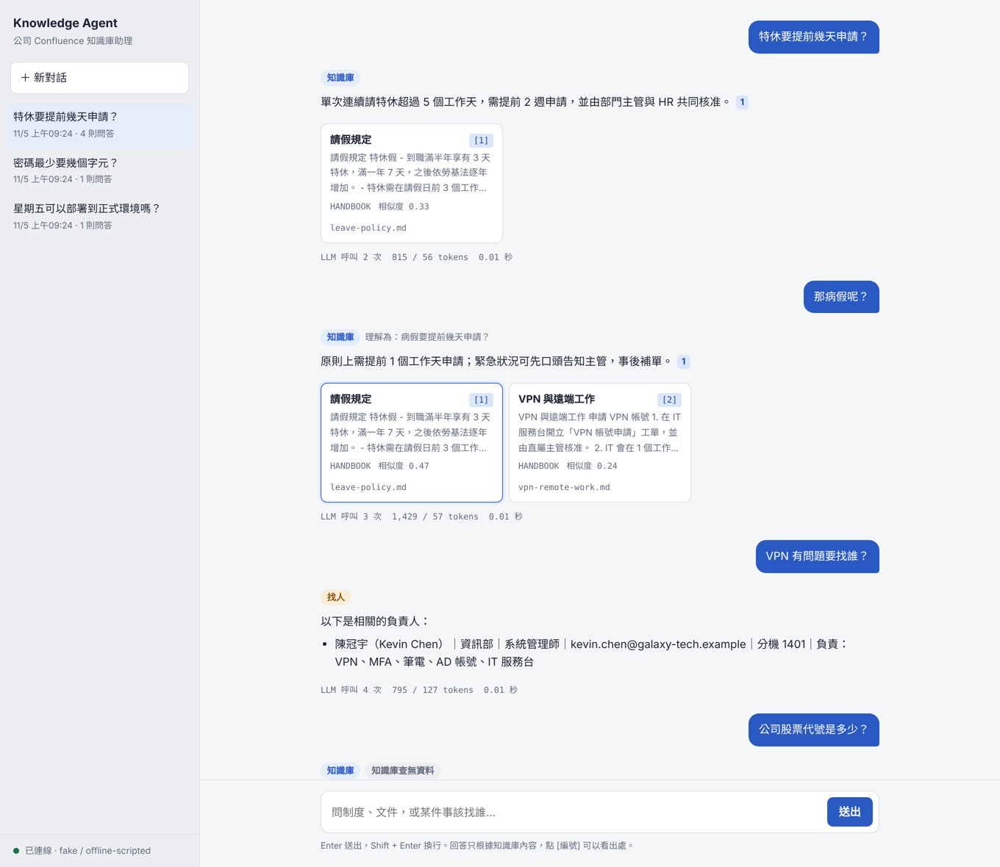
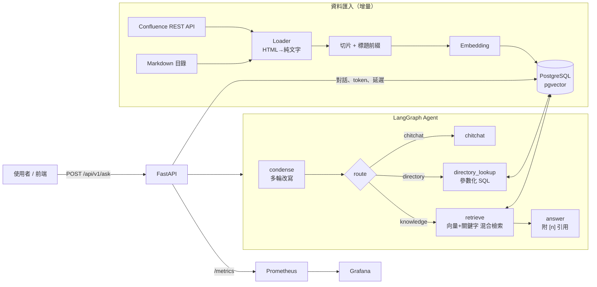

# Confluence Knowledge Agent

把公司的 Confluence（或任何 Markdown 文件）變成**可以用自然語言提問的企業 AI 助理**。
回答都會附上出處；知識庫裡沒有的問題會直接拒答，不會自己編答案。它也能查員工通訊錄，告訴你某件事該找誰。

`Python 3.12` · `FastAPI` · `LangGraph` · `PostgreSQL + pgvector` · `Docker Compose` · `Prometheus / Grafana` · `GitHub Actions`

LLM 可切換 **OpenAI / Azure OpenAI / Gemini / Ollama（本機）**，只要改環境變數。



<sub>截圖使用虛構公司的範例文件，以及不連網的離線示範模型（`LLM_PROVIDER=fake`）。深色模式：[docs/screenshot-dark.jpg](docs/screenshot-dark.jpg)</sub>

---

## 架構



| 元件 | 做什麼 |
|---|---|
| `app/rag/loaders.py` | Confluence REST API（Cloud 和 Server/DC 都支援）、Markdown 載入，XHTML 轉純文字並保留表格列 |
| `app/rag/store.py` | 切片、增量寫入（內容沒變就不重算 embedding）、**混合檢索**（pgvector cosine + 關鍵字，用 RRF 合併） |
| `app/agent/graph.py` | LangGraph 狀態機：改寫問題 → 路由 → 檢索 / 查通訊錄 / 閒聊 |
| `app/chat_service.py` | 對話紀錄存在 PostgreSQL，每則回答都記下 token 和延遲，`/stats` 直接用 SQL 算 p50 / p95 |
| `app/observability/` | JSON 結構化 log（帶 request_id）、Prometheus 指標、LangChain callback 追蹤每次 LLM 呼叫 |
| `eval/` | 評估資料集與腳本：hit@k、MRR、路由正確率、拒答正確率、延遲、token |

## 快速開始

### 方式一：Docker Compose（推薦）

```bash
cp .env.example .env            # 選擇 LLM provider、填入 API key
docker compose up -d --build    # API + PostgreSQL + Prometheus + Grafana
docker compose exec app python -m app.cli seed   # 灌入範例文件與員工資料
```

- 聊天介面：http://localhost:8000
- Swagger：http://localhost:8000/docs
- Grafana：http://localhost:3000（admin / admin，已內建「Knowledge Agent」儀表板）

想完全在本機跑、不用任何 API key：`docker compose --profile local-llm up -d`，
再執行 `docker compose exec ollama ollama pull llama3.1:8b && docker compose exec ollama ollama pull bge-m3`。

### 方式二：本機開發

```bash
pip install -e ".[dev]"
docker compose up -d db
python -m app.cli seed
make dev
```

### 不需要 LLM 的離線示範

設定 `LLM_PROVIDER=fake`、`EMBEDDING_PROVIDER=fake`、`EMBEDDING_DIM=256`，就能把整條流程跑一遍（路由、檢索、引用、監控）。
這時的回答只是檢索到的原文加上引用編號，用來確認流程，不代表真實 LLM 的回答品質。

## API

```bash
curl -s localhost:8000/api/v1/ask -H 'Content-Type: application/json' \
  -d '{"question": "特休要提前幾天申請？"}'
```

```jsonc
{
  "conversation_id": "1b0c…",
  "route": "knowledge",
  "answer": "特休需在請假日前 3 個工作天於 HR 系統提出申請 [1]",
  "sources": [{"title": "請假規定", "url": "leave-policy.md", "score": 0.71, "snippet": "…"}],
  "usage": {"prompt_tokens": 812, "completion_tokens": 64, "llm_calls": 2},
  "latency_ms": 1840
}
```

| Method | Path | 說明 |
|---|---|---|
| POST | `/api/v1/ask` | 提問；帶 `conversation_id` 可延續多輪對話，帶 `space` 可限定搜尋範圍 |
| GET | `/api/v1/conversations` | 對話列表 |
| GET / DELETE | `/api/v1/conversations/{id}` | 對話內容 / 刪除 |
| POST | `/api/v1/ingest` | 匯入 Confluence 或 Markdown（需要 `X-API-Key`） |
| GET | `/api/v1/stats` | 最近 N 天的回答數、token、延遲 p50/p95、路由分佈（需要 `X-API-Key`） |
| GET | `/health`、`/metrics` | 健康檢查、Prometheus 指標 |

匯入自己的 Confluence：在 `.env` 設定 `CONFLUENCE_URL`、`CONFLUENCE_TOKEN`，然後執行
`python -m app.cli ingest-confluence --space ENG`。再跑一次只會更新有變動的頁面。

## 評估

```bash
python -m eval.run_eval --retrieval-only               # 只評估檢索，不花 LLM 費用
python -m eval.run_eval --retrieval-only --vector-only # 對照組：只用向量搜尋
python -m eval.run_eval                                # 端到端：路由、回答、拒答、延遲、token
```

`eval/dataset.jsonl` 共 19 題：14 題知識庫問答、2 題找人、1 題閒聊，還有 2 題知識庫裡沒有、應該拒答的問題。

在 CI 用的基準 embedding（字元雜湊、沒有語意能力）下，混合檢索的提升：

| 檢索方式 | hit@3 | MRR | 拒答正確 |
|---|---|---|---|
| 只用向量 | 57% | 0.57 | 100% |
| **向量 + 關鍵字（RRF）** | **93%** | **0.89** | 100% |

CI 會跑這個評估，**hit@3 低於 85% 就擋下 merge**，避免改壞檢索。
換成 bge-m3 或 text-embedding-3 這類真正的 embedding 後，請自己跑一次更新數字。

## 設計重點

- **拒答比亂答好**：檢索結果不夠相關時，直接回固定訊息，**不呼叫 LLM**。這樣可以避免幻覺，也省 token。門檻 `RETRIEVAL_MIN_SCORE`、`RETRIEVAL_MIN_KEYWORD` 可以調。
- **混合檢索**：向量擅長「意思相近」，關鍵字擅長數字、代號、專有名詞（MFA、P1、3,500 元），兩邊用 RRF 合併排名。
- **不做 text-to-SQL**：查通訊錄時，LLM 只負責抽出一個關鍵字，查詢本身是固定的參數化 SQL。所以不會有 SQL injection，也不會被誘導去讀其他資料表（有測試覆蓋）。
- **成本看得見**：每次 LLM 呼叫的 token 和延遲都會進 Prometheus，也會寫進 `messages` 資料表，可以直接用 SQL 分析每個模型、每條路由的花費。
- **增量同步**：每份文件存 content hash，內容沒變就跳過，大型 Confluence space 重新同步很快。
- **可測試**：LLM 和 embedding 都靠介面注入，測試用不連網的假模型，對真的 PostgreSQL + pgvector 跑。
- **地端也能用的介面**：聊天介面是一個 HTML 檔，由後端直接提供，不載入任何外部字型或 CDN，在不能連外網的環境也能完整顯示。回答裡的 `[n]` 可以點，會標出對應的來源卡片。

## 專案結構

```
app/
  agent/        LangGraph 狀態機與 prompts
  api/          FastAPI routes 與 schemas
  db/           SQLAlchemy models（documents、chunks、conversations、messages、employees）
  llm/          LLM / embedding provider 工廠、離線示範模型
  observability/ metrics、JSON logging、LLM callback
  rag/          loaders、切片、pgvector 混合檢索、匯入流程
  static/       聊天介面（單一 HTML，不依賴外部 CDN）
eval/           評估資料集與腳本
sample_data/    虛構公司的範例文件與員工資料
docker/         Prometheus、Grafana 設定與儀表板
tests/          pytest（API、檢索、Agent 路由、SQL injection 防護）
```

## 開發

```bash
make test   # pytest（需要 PostgreSQL + pgvector：docker compose up -d db）
make lint   # ruff
make eval-retrieval
```

## Roadmap

- [ ] 串流回應（SSE）
- [ ] 依使用者的 Confluence 權限過濾檢索結果（space / page restriction）
- [ ] Reranker（bge-reranker）與 LLM-as-judge 回答品質評估
- [ ] 資料量大時改用 pg_bigm 做中文關鍵字索引
